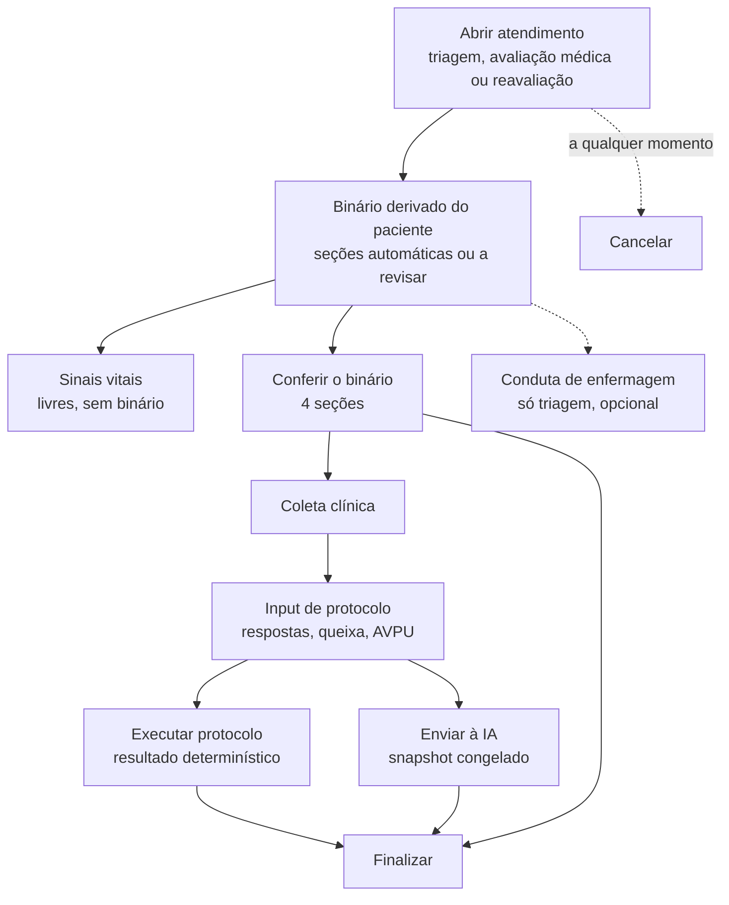
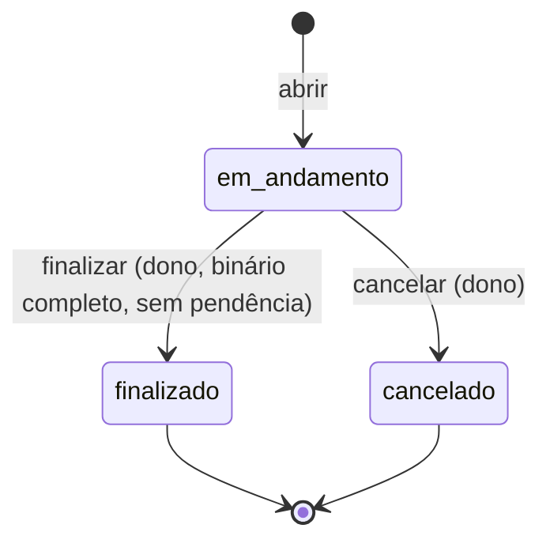
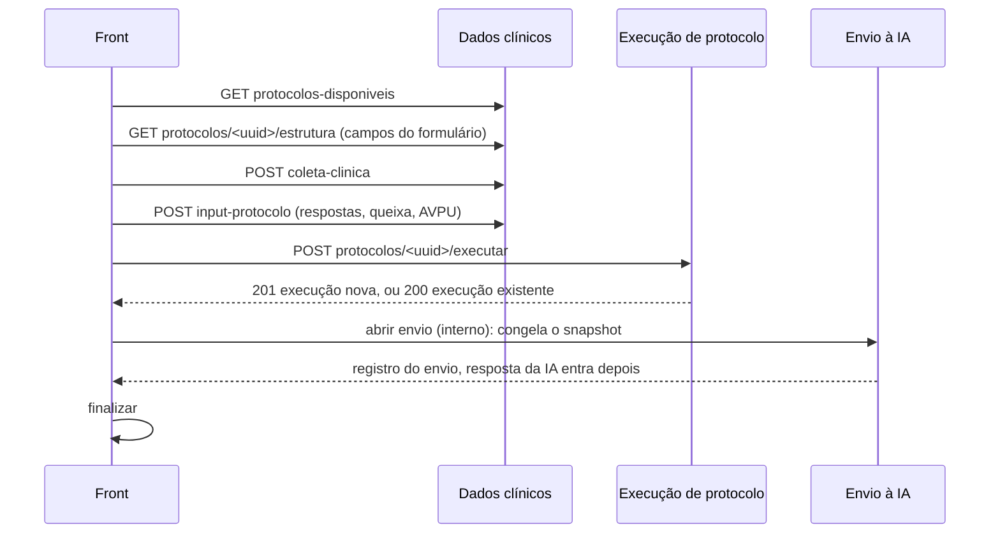

# Atendimento — Fluxo

Visão de ponta a ponta de um Atendimento: da abertura à finalização, passando pelo binário, pelos dados clínicos, pelo protocolo e pelo envio à IA. Cada etapa é detalhada na documentação do módulo correspondente (`atendimento.md`, `binario.md`, `conduta_enfermagem.md`, `dados_clinicos.md`).

---

# Visão geral



Só **um Atendimento em andamento por vez** na Consulta. Dentro dele, as etapas seguem as dependências abaixo, mas **não há ordem rígida** entre os sinais vitais, a conduta de enfermagem e a conferência do binário.

## Estados do atendimento



`finalizado` e `cancelado` são finais: nenhum dado clínico é escrito depois. O status da Consulta é recalculado a cada abertura, finalização e cancelamento, na mesma transação.

---

# Etapas e dependências

| Etapa | Rota (módulo) | Só pode quando | Efeito |
|---|---|---|---|
| Abrir | `abrir-triagem`, `abrir-avaliacao-medica`, `abrir-reavaliacao` (atendimento) | Consulta aberta, consentimento LGPD válido e nenhum atendimento em andamento; reavaliação só com a Consulta em `em-observacao` | Cria o Atendimento e deriva o binário, num commit |
| Sinais vitais | `sinais-vitais` (dados clínicos) | Guard de escrita | Grava o lote inteiro ou nada. **Não** exige binário |
| Conduta de enfermagem | `condutas-enfermagem` (conduta) | Guard de escrita e tipo triagem | Insert-only. **Não** exige binário e **não** bloqueia a finalização |
| Conferir o binário | `binario` e `binario/<secao>` (binário) | Guard de escrita; seção ainda não conferida | Confere as seções e grava o estado no atendimento |
| Coleta clínica | `coleta-clinica` (dados clínicos) | Guard de escrita e **binário completo** | Cria a coleta |
| Input de protocolo | `coleta-clinica/<uuid>/input-protocolo` (dados clínicos) | Guard de escrita, tipo com protocolo e **binário completo**; coleta do próprio atendimento | Insert-only; o último é o vigente |
| Executar protocolo | `protocolos/<uuid>/executar` (dados clínicos) | Guard de escrita, tipo com protocolo, **binário completo**, protocolo ativo, de escopo compatível e liberado pela empresa, e input vigente | Calcula e grava; repetir devolve a execução existente |
| Enviar à IA | (envio à IA, interno) | Guard de escrita, tipo com protocolo, **binário completo** e input de protocolo | Reconcilia o binário e congela o snapshot do que a IA recebe |
| Finalizar | `finalizar` (atendimento) | Dono; binário completo; sem avaliação da IA em andamento; sem prescrição em rascunho | Reconcilia o binário e encerra |
| Cancelar | `cancelar` (atendimento) | Dono; em andamento | Encerra sem exigir nada |

**Guard de escrita** = a checagem comum descrita em `atendimento.md` (atendimento da empresa, paciente certo, dono, função e tipo, em andamento, paciente sem óbito). A permissão (403) é verificada antes do estado (409).

## O que cada tipo de atendimento faz

| Tipo | Abre | Binário | Sinais vitais | Conduta de enfermagem | Protocolo e IA | Finaliza |
|---|---|---|---|---|---|---|
| Triagem | Enfermeiro ou médico | Sim | Sim | Sim | Sim | Quem abriu |
| Avaliação médica | Médico | Sim | Sim | Não | Sim | Médico que abriu |
| Reavaliação | Médico | Sim | Sim | Não | Sim | Médico que abriu |

Enfermeiro só escreve em triagem; médico escreve em qualquer tipo. Na avaliação, o médico lê as condutas de enfermagem da consulta inteira.

---

# Fluxo do binário

```mermaid
sequenceDiagram
    participant P as Paciente (registros ativos)
    participant A as Atendimento novo
    participant U as Profissional
    Note over A: Abertura
    A->>P: compara com a última conferência confirmada
    P-->>A: seção consistente = automatico; mudou = requer-revisao
    U->>A: GET binario (estado e pré-preenchimento)
    U->>A: POST binario ou binario/secao (conferir)
    A->>P: cria itens ou confirma os registros ativos (commit único)
    Note over A: Registro novo pela rota granular depois da conferência
    U->>A: Finalizar ou enviar à IA
    A->>P: reconciliar: alinha o binário aos registros ativos
```

- **Derivação (abertura):** usa só atendimentos **finalizados** anteriores do paciente (até 50). Seção consistente é repassada como `automatico`; seção cujo dado mudou fica `requer-revisao` e **conta como pendente**.
- **Conferência:** cada seção termina em `preenchido`, `nega` ou `nao-coletado`. Reconferir a mesma seção no mesmo atendimento dá 409.
- **Reconciliação:** na finalização e no envio à IA, o binário é alinhado aos registros ativos. Não mexe em seção pendente.
- **Gate:** coleta clínica, input de protocolo, execução de protocolo, envio à IA e finalização exigem as quatro seções conferidas. Sinais vitais, conduta de enfermagem e cancelamento não exigem.

---

# Fluxo do protocolo e da IA



- O **input de protocolo é insert-only**: para ajustar respostas, registra-se outro input (o de maior id vale) e executa-se de novo.
- A **execução** usa só os campos que o protocolo declara (chave de outro protocolo no mesmo input não interfere) e é **idempotente** por input: repetir o mesmo protocolo no mesmo input devolve a execução já existente. Os dados ausentes de todas as execuções do input são consolidados no próprio input.
- O **envio à IA** congela o snapshot do que foi enviado, e só o último envio do atendimento é o vigente. Envio sem resposta significa falha ou em andamento.
- **Finalizar** não pode haver avaliação da IA em andamento (dentro do prazo) nem prescrição em rascunho.

---

# Transação e concorrência

| Operação | Como se protege |
|---|---|
| Abrir atendimento | Trava a linha da **Consulta** (`SELECT ... FOR UPDATE`): duas aberturas simultâneas não criam dois em andamento |
| Conferir binário, executar protocolo, enviar à IA, finalizar, registrar conduta | Trava a linha do **Atendimento**: serializa leitura, alteração e gravação do JSON do binário e revalida o status |
| Conferir várias seções, lote de sinais vitais | Commit único; qualquer falha desfaz tudo |
| Escrita de conduta | Comita junto com o log de auditoria |

---

# Auditoria

As rotas são auditadas com `acesso_auditado`: o log de acesso é gravado **depois** que a view responde, com a operação (`leitura`, `escrita`, `exclusao-logica` ou `exportacao`), o recurso e, quando informado, o `uuid_paciente`. O decorator **não olha o status HTTP**; por isso as views devolvem o par `(resposta, meta)` e, em caso de erro, a meta `{"operacao": "NOOP"}`, que impede o registro e desfaz a transação. Sem o NOOP, um erro seria registrado como acesso com sucesso.

---

# Formato das respostas

| Caso | Corpo |
|---|---|
| Sucesso | `{"status": "success", "message": "...", "data": ...}` |
| Erro | `{"status": "error", "message": "...", "erros": {campo: mensagem}}` |

`erros` só aparece quando o erro pertence a campos específicos; a chave especial `_geral` indica erro sem campo definido. O front pinta o input certo a partir de `erros`, sem interpretar o texto de `message`.

| Exceção | Status |
|---|---|
| `RecursoNaoEncontradoError` | 404 |
| `PermissaoNegadaError` | 403 |
| `DadosInvalidosError` | 422 |
| `ConflictoError` | 409 |
