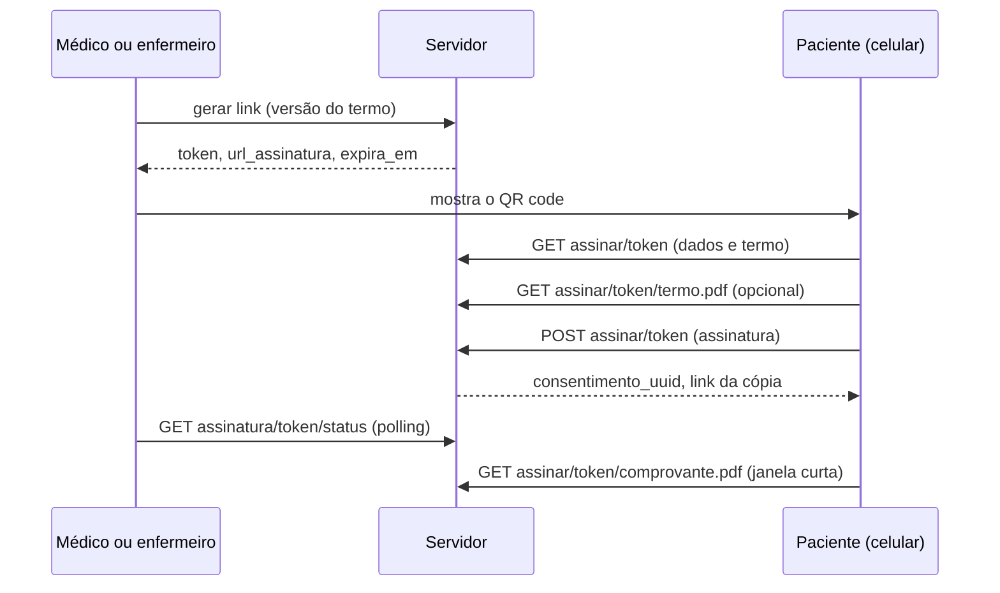

# Consentimento LGPD — Registro manual, assinatura digital e gates

Documentação do módulo de consentimento LGPD do paciente: o registro manual, a assinatura digital por QR code, a revogação, a dispensa por emergência, a situação de consentimento e o gate por escopo. O fluxo completo está em `paciente_fluxo.md`.

---

# Contexto e conceitos

## Visão geral

Consentimento diz respeito ao paciente, mas o **processo** (termo, canal, histórico, revogação) não é pessoal nem clínico: é titularidade/LGPD, domínio à parte. Só o **resultado** (há consentimento ativo) atravessa para o prontuário, como o booleano `consentimento_ativo`.

O consentimento é **prova LGPD** (quem consentiu, quando, com qual termo e hash): **nunca se apaga**. Para desfazer, revoga-se.

## Status

| `status` | Significa |
|---|---|
| `ativo` | Consentimento vigente (no máximo um por paciente) |
| `revogado` | Substituído por um novo ou revogado com motivo |
| `dispensado_emergencia` | Coleta pulada de propósito por urgência (LGPD art. 11, II, "f") |

## Ponto único de criação

Qualquer fluxo (manual, QR code, futuro portal) cria o consentimento ativo pelo **mesmo ponto**, para que a regra "um ativo por paciente" seja igual em todos: ele **revoga todos os ativos anteriores** (travando as linhas) e cria o novo, e a UNIQUE de ativo único barra a corrida (409: "Já existe um consentimento ativo sendo registrado para este paciente. Tente novamente.").

---

# Registro manual

Para os canais `presencial-papel`, `portal-online` e `totem`. O canal `presencial-digital` é **reservado** ao fluxo de QR code e é recusado aqui (422).

| Campo | Regra |
|---|---|
| `versao_termo` | Obrigatório; até 50 caracteres |
| `canal_coleta` | Obrigatório: `presencial-papel`, `portal-online` ou `totem` |
| `escopo_consentimento` | Opcional; `{"escopo": ["codigo", ...]}`, com códigos válidos |
| `hash_documento` | Opcional; SHA-256 em hexadecimal (64 caracteres; vai para minúsculas) |

Códigos de escopo válidos (finalidades **opcionais**):

| Código | Finalidade |
|---|---|
| `marketing` | Comunicações promocionais e ofertas |
| `comunicacao` | Contato por e-mail, SMS ou WhatsApp sobre o atendimento |
| `compartilhamento` | Compartilhar dados com parceiros além do necessário |
| `pesquisa` | Pesquisa científica, anonimizada quando possível |
| `uso_imagem` | Imagens (lesões, exames) para fins didáticos |
| `apoio_ia` | Dados clínicos (sem nome, CPF ou contato) em apoio por inteligência artificial |

Sem escopo = nenhuma finalidade opcional. Códigos desconhecidos ou outro formato são rejeitados (422).

# Revogação

Revoga o consentimento **ativo**, com `motivo` obrigatório (até 1000 caracteres, não pode ser só espaços). 404 se o paciente não existe ou não há consentimento ativo. É **ação sensível** (step-up e log atômico).

# Dispensa por emergência

Registra a dispensa por urgência ou emergência (status `dispensado_emergencia`, canal `dispensa-emergencia`), com `motivo` obrigatório (até 1000 caracteres). **Não substitui nem revoga** o consentimento ativo. Existe também a variante por id interno, para quem acabou de criar o paciente na mesma transação (abertura de consulta de paciente não identificado).

---

# Situação e gates

## Situação

`ativo`, `dispensado_emergencia` ou `None` (ciência pendente).

- Consentimento **ativo** vale sempre.
- A **dispensa** só vale se registrada **a partir do início da consulta**; senão uma dispensa antiga liberaria todas as consultas futuras do paciente.

## Consulta x consentimento

Por padrão a regra **não bloqueia**: a consulta abre com ou sem consentimento, e a pendência é só sinalizada. Para voltar a exigir, defina `CONSENT_BLOQUEIA_CONSULTA=true` no ambiente, sem mudar código; com isso, situação pendente dá 409.

## Gate por escopo

`escopo_permitido(paciente, "apoio_ia")` é verdadeiro só se há consentimento **ativo** que inclui o escopo. **Falha fechada**: sem consentimento, recusa, revogação, dispensa por emergência ou JSON fora do formato, devolve falso. Consulta o banco a cada chamada (sem cache), então uma revogação vale na hora. As finalidades opcionais seguem desligadas sem consentimento, **independente** da chave que bloqueia a consulta.

---

# Assinatura digital (QR code)

O profissional gera um link de curta duração, o paciente abre no próprio celular, lê o termo e assina.

## Geração do link

O texto e o PDF do termo são **montados no servidor** (template da versão + dados da empresa da sessão): o cliente só escolhe a versão (ou usa a vigente) e nunca envia caminho, texto ou unidade. Gerar um link novo **expira os pendentes** do paciente (um pendente por paciente), e o link vale **5 minutos**. Exige paciente com dados pessoais (422 para não identificado ou anonimizado: nesses casos o caminho é a dispensa). A empresa precisa ter o cadastro completo para o termo (razão social, CNPJ, endereço com logradouro, nome e e-mail do DPO), senão 422 listando o que falta.

Resposta: `token`, `url_assinatura`, `expira_em`, `paciente_nome` e `paciente_cpf` (formatado).

## Rotas públicas (o token é a autenticação)

Só atendem sessão **pendente**; sessão vencida é marcada como expirada ao ser tocada. A tela recebe o nome e o **CPF mascarado**, os escopos disponíveis, a versão e o texto do termo, o hash do PDF original e o link do PDF.

## Assinatura

Corpo: `confirmo_identidade` e `declaro_consentimento` (ambos precisam ser `true`), `assinatura_canvas` (PNG em base64 com o prefixo `data:image/png;base64,`), `hash_pdf_original` (precisa igualar o da sessão), e opcionais `user_agent`, `geolocalizacao`, `geo_divergente` e `escopos_selecionados`.

Registrar a assinatura **trava a linha da sessão** (um segundo POST simultâneo espera e enxerga "usado") e grava, num **único commit**, a revogação do consentimento anterior, o novo consentimento (canal `presencial-digital`, com a prova da assinatura) e a sessão como usada. Resposta: `consentimento_uuid`, `hash_pdf_final`, `data_consentimento`, `download_url` e `copia_valida_ate`.

## PDF e integridade

O PDF assinado **não é guardado em disco**: é refeito em memória a partir do texto aceito, da assinatura, da auditoria e da data, de forma determinística (mesmos dados, mesmos bytes), e o hash refeito é comparado ao gravado. O download do médico informa o resultado em `X-Integridade` (`confere` ou `divergente`; pode divergir se a biblioteca de PDF ou o layout mudarem, ou se o paciente foi anonimizado).

O paciente baixa a **própria cópia** por tempo limitado após assinar (`CONSENT_JANELA_COPIA_MIN`, padrão 15 minutos). Todo caso inválido do download da cópia responde **404 igual**, para o token não revelar em que estado está.

## Termo

Os templates ficam em `termos/termo_<versao>.txt`, versionados: **template publicado não se edita** (mudou o texto, nova versão). O renderizador usa variável obrigatória (variável faltando é erro, nunca "[CNPJ]" vazio), valida a versão por regex (sem `/`, `\` ou `..`) e a versão vigente vem de `CONSENT_VERSAO_TERMO_VIGENTE` ou do template mais recente.

## Limpeza

Sessões **não usadas** e vencidas há mais de N dias podem ser apagadas por uma rotina de limpeza (7 dias por padrão). Sessões `usado` **nunca** são apagadas: são prova da assinatura.

---

# Estrutura de arquivos

| Arquivo | Papel |
|---|---|
| `controllers/lgpd_controller.py` | Rotas do fluxo manual |
| `controllers/consentimento_digital_controller.py` | Rotas da assinatura digital |
| `services/consentimento_service.py` | Regras do consentimento e gates |
| `services/consentimento_digital_service.py` | Orquestração da sessão de assinatura |
| `repositories/consentimento_repository.py` | Acesso a dados do consentimento |
| `repositories/consentimento_sessao_assinatura_repository.py` | Acesso a dados da sessão de assinatura |
| `schemas/schema_consentimento.py` e `schema_consentimento_digital.py` | Schemas de entrada |
| `termos/` | Renderizador do termo, PDF assinado e templates |
