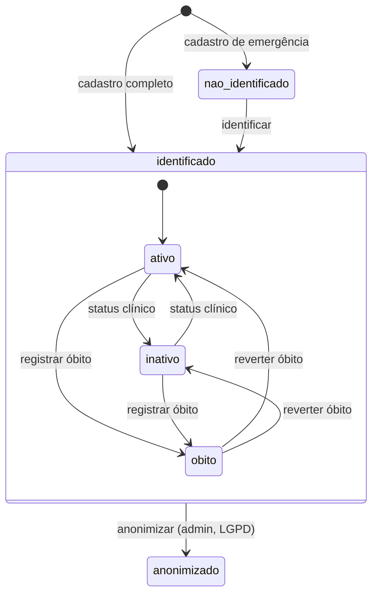
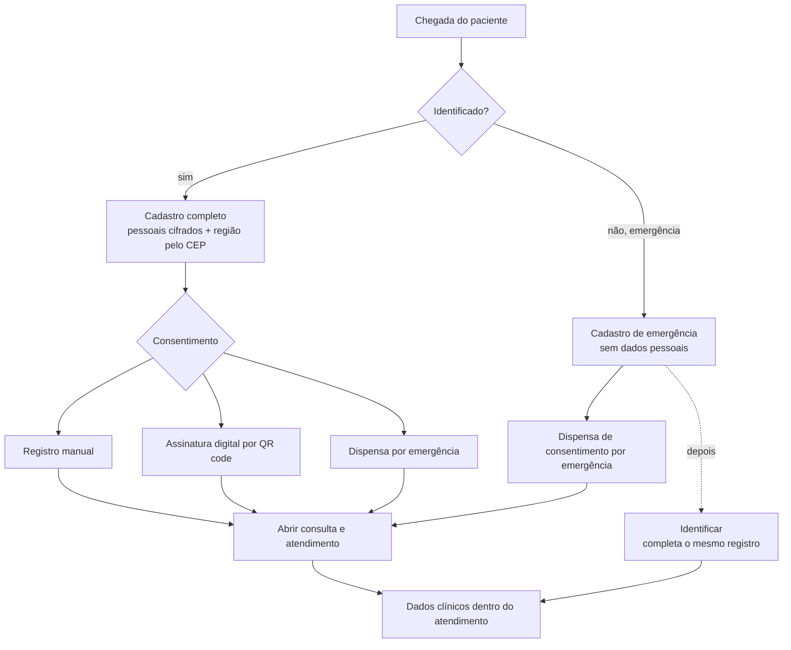
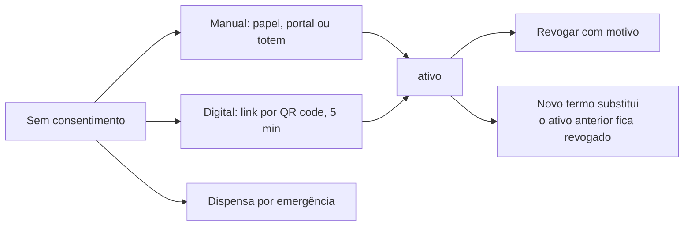
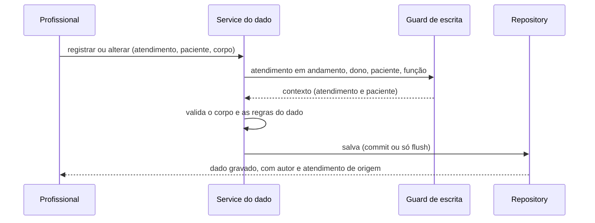

# Paciente — Fluxo

Visão de ponta a ponta do ciclo de vida de um paciente: do cadastro (normal ou de emergência) ao consentimento, aos dados clínicos registrados nos atendimentos e ao encerramento (óbito ou anonimização). Cada parte está detalhada em `paciente.md`, `alergia.md`, `doenca_cronica.md`, `medicamento_em_uso.md`, `tipo_sanguineo.md` e `consentimento.md`.

---

# Situações do paciente

- `nao_identificado` ainda **não tem** dados pessoais; `anonimizado` já teve e os perdeu (irreversível).
- Paciente **nunca é apagado**: o prontuário e as consultas dependem dele.
- Paciente com óbito registrado **não recebe atendimento** e não é identificado por este fluxo, mas o histórico segue consultável e o cadastro pode ser corrigido.

---

# Do cadastro ao atendimento

- O **CPF é único por empresa**; a mesma pessoa pode existir em empresas diferentes.
- A **região** é sempre derivada do CEP; sem região resolvida, o cadastro falha.
- Por padrão o consentimento **não bloqueia** a abertura da consulta (a pendência é só sinalizada); a chave `CONSENT_BLOQUEIA_CONSULTA` muda isso sem alterar código.
- As **finalidades opcionais** (por exemplo, apoio por IA) seguem desligadas sem consentimento ativo que inclua o escopo.

---

# Consentimento

| Fluxo | Quem | Resultado |
|---|---|---|
| Registro manual | Médico ou enfermeiro | Consentimento ativo (revoga o anterior) |
| Assinatura digital | Paciente, pelo token do link | Consentimento ativo, com prova da assinatura e PDF refeito em memória |
| Dispensa por emergência | Médico ou enfermeiro | Registro de dispensa; **não** revoga o ativo |

Há **um consentimento ativo por paciente**, garantido no ponto único de criação. A dispensa só vale para a consulta cujo início é anterior a ela.

---

# Dados clínicos dentro do atendimento

Toda escrita de alergia, reação, doença crônica, medicamento em uso, tipo sanguíneo e binário acontece **dentro de um Atendimento em andamento do próprio profissional**, pela checagem comum de escrita clínica (ver `atendimento.md`).

| Dado | Como muda | Histórico |
|---|---|---|
| Alergia | Atualiza código e confirmação; reação é registrada à parte | Remoção lógica; reação imutável |
| Doença crônica | **Revisão** fecha a vigente e cria a nova; `observacoes` no lugar | Linha do tempo preservada |
| Medicamento em uso | **Substituir** (fecha e cria) ou encerrar | Encerrados ficam como histórico |
| Tipo sanguíneo | Nova observação (insert-only) | Todas as observações |

Regras comuns: nada é apagado fisicamente (remoção é lógica, com motivo, autor e atendimento); **remover e restaurar são ações sensíveis** (step-up e log atômico); não se duplica registro ativo equivalente (mesma substância, mesmo CID vigente, mesmo medicamento ativo).

Com `commit` desligado o service só dá flush, e o commit é de quem compõe a operação: a **rota agregada do binário** (várias seções, um commit) e as **ações sensíveis** (alteração e log na mesma transação).

---

# Prontuário

O prontuário clínico completo é montado **só na tela de detalhe**: paciente, tipo sanguíneo vigente, alergias (grave primeiro), doenças vigentes, medicamentos em uso, interações entre os ativos e o resumo clínico do topo. Nunca em listagem (cada domínio é uma consulta própria). O consentimento entra só como `consentimento_ativo`.

---

# Encerramento

| Ação | Quem | Efeito |
|---|---|---|
| Inativar | Médico, enfermeiro (admin como exceção auditada) | `status = inativo` |
| Registrar óbito | Médico, enfermeiro (admin como exceção auditada) | `status`, `falecido` e `data_obito` juntos; exige que não haja consulta aberta |
| Reverter óbito | Médico, enfermeiro (ação sensível) | Limpa o óbito e volta a `ativo` ou `inativo` |
| Anonimizar | Admin (ação sensível, justificativa obrigatória) | Apaga os dados pessoais, mantém o prontuário clínico anonimizado |

---

# Transação e auditoria

| Operação | Como se protege |
|---|---|
| Cadastro completo | Paciente e dados pessoais num commit único; CPF duplicado em corrida é barrado pela UNIQUE composta (409) |
| Assinatura digital | Trava a sessão; revogação do anterior, novo consentimento e sessão usada num commit único |
| Ações sensíveis | Alteração e log de auditoria na mesma transação (o service roda com `commit=False`) |
| Leituras sensíveis | Log de acesso; no erro, a meta `NOOP` impede o registro como sucesso |
| Isolamento | Toda busca filtra a empresa da sessão; "não existe" e "é de outra empresa" dão o mesmo 404 |
