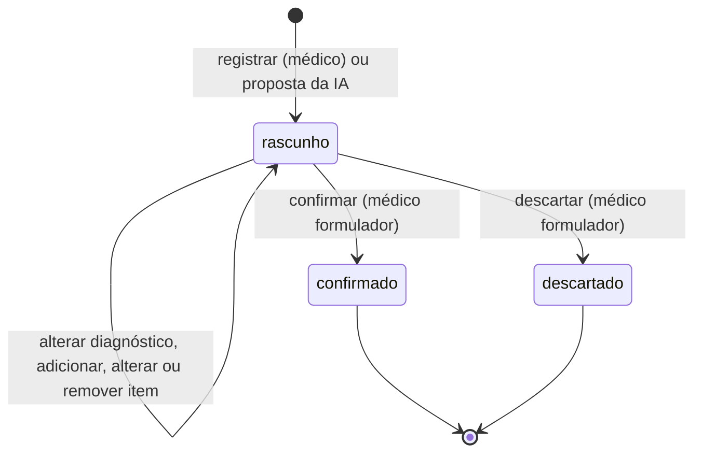
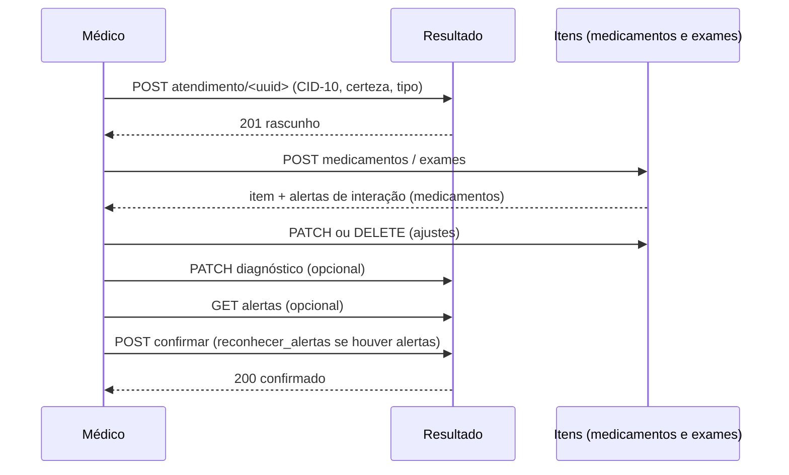
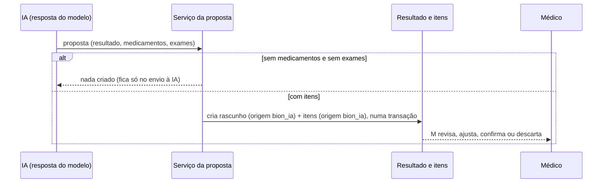

# Prescrição — Fluxo

Visão de ponta a ponta de uma prescrição: do rascunho (manual ou proposto pela IA) à confirmação. Cada parte está detalhada em `resultado_prescricao.md`, `prescricao.md` e `prescricao_exame.md`. O fluxo do atendimento que contém a prescrição está em `atendimento_fluxo.md`.

---

# Estados do resultado

`confirmado` e `descartado` são finais: não se altera, não se descarta de novo. Só o rascunho aceita edição, e só com o atendimento **em andamento**. O descarte é a exceção: vale mesmo com o atendimento finalizado ou cancelado.

---

# Fluxo manual (médico)

Etapas e regras:

| Etapa | Pré-condição | Efeito |
|---|---|---|
| Registrar | Médico dono, atendimento em andamento, **sem outro rascunho** | Cria o rascunho (origem `medico`) |
| Adicionar item | Rascunho editável | Cria o item (origem `medico`); resultado passa a `medico`; medicamento ou exame repetido dá 409 |
| Alterar ou remover item | Rascunho editável | Item e resultado passam a `medico` (alterar sem mudança real não grava nada) |
| Corrigir diagnóstico | Rascunho editável | Só os campos enviados; resultado passa a `medico` |
| Confirmar | Rascunho editável; se farmacológica, ao menos um medicamento; alertas (entre os itens e com os medicamentos em uso do paciente) reconhecidos | `confirmado`, com `confirmado_em` |
| Descartar | Médico formulador; não confirmado | `descartado`, com data, autor e motivo |

---

# Fluxo com IA

- A proposta é validada pelas **mesmas classes** das rotas do médico; item inválido (UUID inexistente ou repetido) **desfaz tudo**.
- **Não escreve** se o atendimento não está em andamento ou se há rascunho do **médico** (409). Um rascunho anterior da própria IA pode coexistir com a nova proposta, e a IA nunca sobrescreve o que o médico está editando.
- Assim que o médico mexe em qualquer coisa, o resultado vira `medico` e a IA deixa de poder trocá-lo.

---

# Origens (quem responde pelo conteúdo)

| Situação | Origem do resultado | Origem dos itens |
|---|---|---|
| Criado pela IA | `bion_ia` | `bion_ia` |
| Médico adiciona item a um rascunho da IA | `medico` | O novo, `medico`; os da IA ficam `bion_ia` |
| Médico altera um item da IA | `medico` | Esse item vira `medico` |
| Médico remove item da IA ou corrige o diagnóstico | `medico` | Os demais ficam como estavam |
| Criado pelo médico | `medico` | `medico` |

A sugestão original da IA permanece registrada no envio à IA, independentemente do que o médico faça depois.

---

# Relação com o atendimento

- Um **rascunho** de prescrição **impede finalizar** o atendimento (confirmar ou descartar antes). Resultado `confirmado` ou `descartado` não bloqueia.
- Descartar um rascunho antigo é permitido mesmo depois de o atendimento terminar, para não deixar rascunho preso.

---

# Transação e auditoria

| Operação | Como se protege |
|---|---|
| Registrar rascunho | **Trava o atendimento** antes de checar os rascunhos: duas criações simultâneas não geram dois |
| Adicionar, alterar ou remover item, corrigir diagnóstico, confirmar | **Trava a linha do resultado** até o commit e confere o status depois da trava: alterações simultâneas se serializam |
| Adicionar, alterar ou remover item | Item e troca de origem do resultado saem num **commit único**; falha desfaz tudo |
| Proposta da IA | Resultado e todos os itens num **commit único** |
| Auditoria | Acesso auditado em toda rota (exceto a de alertas); o erro devolve a meta `NOOP` para não ser registrado como sucesso |
