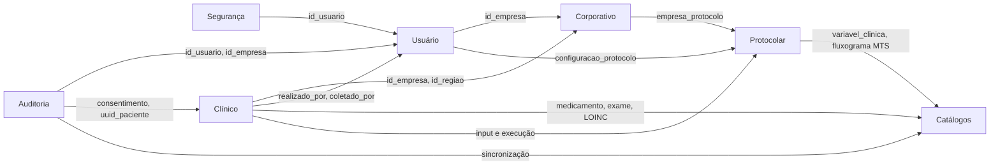
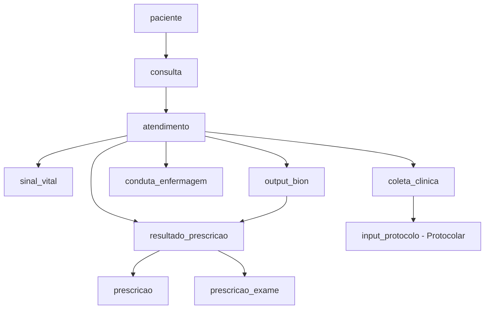

# Banco de Dados: Domínios e Lógica

Documentação do schema `bion_testes`, organizada pelos mesmos domínios em que o código está dividido. O objetivo é mostrar como o banco se reflete no código: o que cada domínio guarda, a lógica que as constraints impõem e, principalmente, **onde um domínio encosta em outro**.

Só as tabelas principais são explicadas. Tabelas de apoio (snapshots, relacionamentos N:N, logs) aparecem em uma linha.

---

# Visão geral

O sistema é um backend de apoio clínico multiempresa. Uma **empresa** (unidade de saúde) tem **usuários** profissionais, que atendem **pacientes** em **consultas**. Durante o atendimento, protocolos clínicos são executados sobre os dados coletados, a IA (Bion) gera sugestões, e o profissional formula **prescrições**. Tudo isso apoiado por **catálogos** compartilhados (medicamentos, exames, LOINC, protocolos), protegido por camadas de **segurança** e rastreado por **auditoria**.

| Domínio | Papel em uma frase |
|---|---|
| Corporativo | Quem é o cliente (empresa), onde fica e quais protocolos ele libera |
| Usuário | Quem são os profissionais, seu papel e suas preferências |
| Segurança | Como o usuário prova quem é (2º fator e reconfirmação) |
| Auditoria | Quem acessou e alterou o quê, e consentimento LGPD |
| Catálogos | Dados de referência compartilhados entre todas as empresas |
| Protocolar | Como protocolos clínicos são montados, versionados e executados |
| Clínico | O paciente, o atendimento e tudo que é registrado nele |

## Mapa de pontes entre domínios

**Regra geral de multi-tenancy:** a empresa é a fronteira de isolamento. Ela é gravada diretamente em `paciente`, `paciente_dados_pessoais`, `consulta`, `usuarios`, `log_acesso` e `log_alteracao`. O resto do clínico herda a empresa pela cadeia paciente → consulta → atendimento.

---

# 1. Corporativo

Representa o cliente do sistema e o que ele tem habilitado.

## Tabelas principais

| Tabela | Propósito |
|---|---|
| `empresas` | A unidade de saúde. Tem plano, status do plano e DPO (LGPD). Raiz do isolamento multiempresa |
| `empresa_protocolo` | **Quais protocolos a empresa libera.** Define se está ativo, a política (`obrigatorio` ou `opcional`), o default institucional por escopo e quem da governança clínica aprovou |
| `regiao_geografica` | Município/região com código IBGE, UF, centroide e população. Usada para endereçar empresas e pacientes |

## Tabelas de apoio

| Tabela | Função |
|---|---|
| `empresa_identificador` | CNPJ e CNES da empresa, um de cada tipo |
| `tipo_jurisdicao` | Domínio de níveis de jurisdição (mapeado para FHIR) que classifica a região |

## Lógica

- **Política de protocolo.** `obrigatorio` significa que o profissional não pode pausar o protocolo na sua preferência pessoal. `opcional` deixa livre. É a empresa que manda, o usuário só personaliza dentro do que foi liberado.
- **Default institucional.** `escopo_default_institucional` (triagem, consulta ou ambos) aceita um único protocolo por escopo por empresa, garantido pela unique `(id_empresa, escopo_default_institucional)`. Como MySQL aceita múltiplos NULL, os protocolos não-default convivem sem conflito.
- **Governança.** `aprovado_por` e `aprovado_em` registram quem liberou ou alterou o protocolo para a empresa.

## Pontes

| De | Para | Como |
|---|---|---|
| `empresa_protocolo` | Protocolar (`protocolo_catalogo`) | Qual protocolo foi liberado |
| `empresa_protocolo.aprovado_por` | Usuário (`usuarios`) | Quem aprovou |
| `regiao_geografica` | Clínico (`paciente`) | Região de residência do paciente |
| `empresas` | Todos os domínios | `id_empresa` como chave de isolamento |

---

# 2. Usuário

Os profissionais que operam o sistema e suas preferências.

## Tabelas principais

| Tabela | Propósito |
|---|---|
| `usuarios` | Conta do profissional, sempre vinculada a uma empresa. Guarda login, hash de senha, vínculo Google (`google_sub`), flags de admin/super admin e estado de onboarding. CPF é guardado cifrado, com `cpf_hash` para busca e unicidade |
| `papel_profissional` | A função clínica do usuário (`medico` ou `enfermeiro`) com número e UF do conselho, especialidade e RQE. Um usuário pode ter um papel de cada tipo |
| `configuracao` | Preferências pessoais do usuário, em JSON. Uma por usuário |
| `configuracao_protocolo` | **Os protocolos que o usuário favoritou e usa.** Cada linha diz se está em uso e se é o default pessoal de um escopo |

## Lógica

- **Papel não é conta.** Ser médico ou enfermeiro é uma propriedade de `papel_profissional`, não de `usuarios`. Por isso as tabelas clínicas gravam `funcao_clinica` junto de `realizado_por`, para registrar *em qual papel* a pessoa agiu.
- **Preferência dentro do liberado.** `configuracao_protocolo.em_uso = 0` pausa o protocolo sem apagar a escolha. Isso só vale para protocolos `opcional` na empresa.
- **Default pessoal.** Mesma lógica do default institucional: `escopo_default` aceita um protocolo por escopo por configuração.
- **Onboarding.** `onboarding_pendente` e `senha_versao` sustentam o fluxo de primeiro acesso e a invalidação de sessões após troca de senha (ver `auth.md`).

## Pontes

| De | Para | Como |
|---|---|---|
| `usuarios.id_empresa` | Corporativo | A qual empresa o profissional pertence |
| `configuracao_protocolo.id_protocolo` | Protocolar | Qual protocolo foi favoritado |
| `usuarios` | Clínico, Protocolar, Auditoria, Segurança | É referenciado como autor em quase tudo (`criado_por`, `realizado_por`, `executor`, `alterado_por`...) |

---

# 3. Segurança

Autenticação forte. O fluxo completo está em `auth.md`; aqui está só o reflexo no banco.

## Tabelas principais

| Tabela | Propósito |
|---|---|
| `credencial_webauthn` | Credenciais WebAuthn do usuário (chave pública, contador de uso, apelido do dispositivo). Sustenta o 2º fator e o step-up preferencial |
| `stepup_token` | Token de uso único e vida curta emitido após reconfirmação de identidade, vinculado a `(usuário, ação)` |
| `stepup_reautenticacao` | Estado intermediário do fallback senha + Google. Persistido no banco porque atravessa um redirect de navegador |

## Tabelas de apoio

| Tabela | Função |
|---|---|
| `credencial_totp` | Segredo TOTP por usuário, com flag de confirmação |

## Lógica

- **Existir credencial muda o fluxo.** Usuário com WebAuthn cadastrado passa por `mfa_pendente` no login por senha. Sem credencial, a sessão é liberada direto.
- **Token consumível.** `stepup_token` é lido uma vez e apagado, com `expira_em` curto. A rota sensível não sabe qual método gerou o token.
- **Vínculo com a ação.** Tanto o token quanto o estado de reautenticação guardam `acao`, para não confirmar uma ação e executar outra.
- **Limpeza em cascata.** Credenciais TOTP e tokens de step-up têm `ON DELETE CASCADE` com o usuário.

## Pontes

| De | Para | Como |
|---|---|---|
| Todas as tabelas do domínio | Usuário (`usuarios`) | `id_usuario` |
| `stepup_*.is_super_admin` | Usuário | Replica o nível do usuário no momento da reconfirmação |

O domínio é deliberadamente pequeno e fechado: só depende de `usuarios`.

---

# 4. Auditoria

Rastreabilidade de acesso, de alteração e de consentimento. É o domínio com mais pontes, porque observa todos os outros.

## Tabelas principais

| Tabela | Propósito |
|---|---|
| `log_acesso` | Quem acessou qual recurso, sobre qual paciente, com qual operação (leitura, escrita, exclusão lógica, exportação), de qual IP e com qual resultado (inclui acesso negado) |
| `log_alteracao` | Quem mudou qual campo de qual registro, com valor anterior e novo, justificativa e ação. É **genérico**: aponta para qualquer tabela via `tabela_origem` + `id_registro` + `uuid_registro` |
| `consentimento_lgpd` | Consentimento do paciente: versão do termo, canal de coleta, escopo em JSON, status e assinatura. Inclui `dispensado_emergencia` |
| `consentimento_sessao_assinatura` | Sessão temporária (token) para o paciente assinar o termo em outro dispositivo, com hash do PDF, IP, user agent e geolocalização |

## Tabelas de apoio

| Tabela | Função |
|---|---|
| `log_sincronizacao_catalogo` | Histórico de criação e atualização de medicamentos no catálogo (antes e depois, em JSON) |

## Lógica

- **Um consentimento ativo por paciente.** A coluna gerada `ativo_unico` vale 1 quando `status = 'ativo'` e NULL caso contrário. Com a unique `(id_paciente, ativo_unico)`, o banco impede dois consentimentos ativos, mas aceita qualquer quantidade de revogados ou expirados.
- **Consentimento em duas etapas.** O médico gera uma sessão (`consentimento_sessao_assinatura`) que expira. Quando o paciente assina, o registro definitivo nasce em `consentimento_lgpd` e a sessão fica `usado`. A sessão guarda o snapshot do texto e o hash do PDF, para provar o que foi assinado.
- **Log sem FK para o paciente.** `log_acesso.uuid_paciente` e `log_alteracao.uuid_registro` guardam o UUID, não uma chave estrangeira. O log sobrevive mesmo que o registro original mude ou seja removido.
- **Isolamento por empresa.** Ambos os logs carregam `id_empresa`, com índices pensados para consulta por empresa e período.

## Pontes

| De | Para | Como |
|---|---|---|
| `consentimento_lgpd.id_paciente` | Clínico (`paciente`) | A quem pertence o consentimento |
| `consentimento_lgpd.coletado_por`, `sessao.id_medico_gerador` | Usuário | Quem coletou ou gerou |
| `log_acesso`, `log_alteracao` | Usuário e Corporativo | Quem agiu e em qual empresa |
| `log_acesso.uuid_paciente`, `log_alteracao.uuid_registro` | Clínico (e qualquer tabela) | Referência lógica, sem FK |
| `log_sincronizacao_catalogo.id_catalogo` | Catálogos (`catalogo_medicamentos`) | Qual medicamento foi sincronizado |

---

# 5. Catálogos

Dados de referência **globais**: não têm `id_empresa` e são compartilhados por todos os clientes.

## Tabelas principais

| Tabela | Propósito |
|---|---|
| `catalogo_medicamentos` | Princípio ativo, classe farmacêutica e nomes comerciais. O nome normalizado é único |
| `interacoes_medicamentos` | Interação entre dois medicamentos (par A, B único), com gravidade, mecanismo e recomendação |
| `catalogo_exames` | Exames com código TUSS, tipo, material, jejum e vínculo LOINC. Possui nome normalizado para busca |
| `loinc_termo` | Base LOINC importada (código, componente, propriedade, sistema, ranks) |
| `variavel_clinica` | Dicionário das variáveis clínicas (numérica, categórica ou booleana) com limites e unidade. É o vocabulário que os módulos de protocolo consomem |
| `catalogo_fluxogramas_mts` | Fluxogramas do Manchester Triage System, com estrutura em JSON |

## Tabelas de apoio

| Tabela | Função |
|---|---|
| `catalogo_medicamentos_indicacoes`, `_contraindicacoes` | Ligam medicamento a `indicacoes_terapeuticas` e `contraindicacoes` (N:N) |
| `catalogo_medicamentos_sinonimos` | Nomes alternativos para busca |
| `catalogo_exames_conteudo`, `_conteudo_consulta` | Conteúdo educativo buscado em fontes externas por exame e idioma, e o registro de cada tentativa de busca |
| `loinc_termo_traducao`, `loinc_painel_item` | Traduções do LOINC e composição de painéis (painel → exames filhos) |
| `loinc_sinal_vital` | Mapeia cada tipo de sinal vital ao código LOINC e à unidade UCUM |

## Lógica

- **Normalização para busca.** Medicamentos e exames têm uma coluna `*_normalizado` única. É a chave anti-duplicidade e a base da busca por texto.
- **LOINC como espinha dorsal.** Exames, sinais vitais e variáveis clínicas se ancoram no LOINC. Só `catalogo_exames` tem FK real para `loinc_termo`; em `variavel_clinica` o `codigo_loinc` é uma referência solta.
- **Rastro de atualização.** `ultima_verificacao_em` e `fonte_origem` indicam de onde veio cada dado e quando foi conferido, e o log de sincronização guarda o histórico.
- **Intocado pelo clínico.** O clínico nunca altera catálogo; ele só referencia.

## Pontes

| De | Para | Como |
|---|---|---|
| `medicamentos_em_uso`, `prescricao`, `interacoes_medicamentos` (consumo) | Clínico → Catálogos | Medicamento escolhido a partir do catálogo |
| `prescricao_exame.id_exame` | Clínico → Catálogos | Exame solicitado |
| `sinal_vital.tipo_parametro` | Clínico → Catálogos (`loinc_sinal_vital`) | Tipo e unidade padronizados |
| `modulo_versao_campo.id_variavel` | Protocolar → Catálogos (`variavel_clinica`) | Quais variáveis cada módulo exige |
| `protocolo_mts.id_fluxo_mts` | Protocolar → Catálogos | Protocolo que usa um fluxograma Manchester |
| `log_sincronizacao_catalogo` | Auditoria → Catálogos | Histórico de sincronização |

---

# 6. Protocolar

O motor de protocolos clínicos (escores, classificações, regras). É um modelo **em camadas e versionado**: módulos são blocos de cálculo reutilizáveis, e protocolos são composições de módulos.

## Tabelas principais

| Tabela | Propósito |
|---|---|
| `protocolo_catalogo` | O protocolo em si (sigla única), com tipo de resultado (score, categoria-cor, nível de risco, binário), população-alvo, escopo de uso e órgão emissor |
| `protocolo_versao` | Cada versão de um protocolo, com vigência e status. Guarda o `codigo_composicao`, um número único que identifica a combinação de módulos da versão |
| `catalogo_modulos` | Bloco de cálculo reutilizável: tipo (epidemiológico, comorbidade, faixa-etária, institucional), família (pontuador, classificador, regra) e tipo de saída. Tem `indice_bit` único |
| `modulo_versao` | Versão de um módulo, com a configuração e a explicação em JSON |
| `protocolo_composicao` | Liga uma versão de protocolo às versões de módulo que a compõem, com papel (`principal`, `gatilho`, `informativo`) e ordem |
| `protocolo_composicao_config` | Como os módulos de uma versão se agregam (nenhuma, soma, máximo, pior categoria, qualquer flag) e a regra de gatilho |
| `input_protocolo` | Os dados de entrada de uma execução, em JSON, mais queixa principal e AVPU |
| `input_protocolo_execucao` | O resultado calculado de um protocolo sobre um input, com status e a **versão exata utilizada** |

## Tabelas de apoio

| Tabela | Função |
|---|---|
| `modulo_versao_campo` | Variáveis exigidas por cada versão de módulo (obrigatória ou não, ordem) |
| `protocolo_mts` | Liga um protocolo a um fluxograma Manchester |
| `protocolo_escore_config` | Parâmetros, faixas de interpretação e regra de override de um escore, com checksum e quem publicou |

## Lógica

- **Três níveis de versionamento.** Protocolo → versão do protocolo → versões de módulo. Mudar a regra de um módulo cria uma nova `modulo_versao`; mudar a combinação cria uma nova `protocolo_versao`. Nada é sobrescrito.
- **Execução reprodutível.** `input_protocolo_execucao.id_versao_utilizada` fixa qual versão calculou aquele resultado. Uma execução antiga continua explicável mesmo depois de o protocolo evoluir.
- **Compatibilidade família ↔ saída.** A constraint em `catalogo_modulos` obriga: pontuador → pontos, classificador → categoria, regra → flag. O tipo de módulo determina o tipo de resultado possível.
- **Limite de módulos.** `indice_bit` aceita 0 a 62, o que se encaixa em um inteiro de 64 bits. Isso sugere que `codigo_composicao` seja uma máscara de bits dos módulos presentes na versão (inferência do schema; vale confirmar no código).
- **Gatilho não agrupa.** Um módulo com papel `gatilho` não pode ter `grupo_agregacao`. Gatilhos disparam regras, não entram na soma.
- **Entrada validada pelo catálogo.** O que um módulo aceita é definido por `variavel_clinica`, incluindo faixas e opções válidas.

## Pontes

| De | Para | Como |
|---|---|---|
| `input_protocolo.id_coleta_clinica` | Clínico (`coleta_clinica`) | De qual coleta vieram os dados |
| `input_protocolo_execucao.executor` | Usuário | Quem executou |
| `empresa_protocolo`, `configuracao_protocolo` | Corporativo e Usuário → Protocolar | Quem libera e quem favorita cada protocolo |
| `conduta_enfermagem.id_protocolo_catalogo` | Clínico → Protocolar | Conduta tomada com base em um protocolo |
| `modulo_versao_campo` | Protocolar → Catálogos | Variáveis do dicionário clínico |
| `protocolo_escore_config.publicado_por` | Protocolar → Usuário | Quem publicou a configuração |

---

# 7. Clínico

O núcleo do negócio: o paciente e tudo que acontece em um atendimento.

## Hierarquia do atendimento

## Tabelas principais

| Tabela | Propósito |
|---|---|
| `paciente` | Dados clínicos e demográficos do paciente, **sem identificação direta**. Pertence a uma empresa |
| `paciente_dados_pessoais` | Dados identificáveis (nome, CPF cifrado, contatos) separados do clínico. Um registro por paciente |
| `consulta` | A passagem do paciente pela unidade, do início ao desfecho. Passa por estados: aguardando triagem, em triagem, aguardando médico, em atendimento, em observação, encerrada |
| `atendimento` | Cada ato profissional dentro de uma consulta (triagem, avaliação médica, reavaliação, alta, procedimento), com o profissional responsável |
| `coleta_clinica` | Ponto de coleta de dados de um atendimento, ligado ao input dos protocolos |
| `sinal_vital` | Medições (pressão, FC, temperatura...) com unidade, sítio de medição e flag de validação de faixa |
| `output_bion` | O que a IA devolveu para um atendimento: input e output em JSON, versão do modelo, índices de completude e confiança, status e nota de avaliação do profissional |
| `resultado_prescricao` | Diagnóstico principal (CID-10) e certeza diagnóstica de um atendimento, com status (rascunho, confirmado, descartado) e origem (médico, IA, protocolo) |
| `prescricao` | Cada medicamento prescrito, com dose, frequência e duração |
| `prescricao_exame` | Cada exame solicitado, com urgência e justificativa |

## Tabelas de apoio (histórico do paciente)

| Tabela | Função |
|---|---|
| `alergia` e `reacao_alergia` | Alergias do paciente e as reações associadas (manifestação e gravidade) |
| `doenca_cronica` | Doenças crônicas por CID-10, com data de início, remissão e encerramento |
| `medicamentos_em_uso` | Medicamentos que o paciente já usa, com período de uso |
| `observacao_tipo_sanguineo` | Registros de tipo sanguíneo ao longo do tempo |
| `conduta_enfermagem` | Condutas de enfermagem registradas no atendimento |

## Lógica

- **Separação identificação × clínico.** Quem lê dados clínicos não precisa ver nome ou CPF. `paciente_dados_pessoais` é a única ponte para a identidade, com unicidade de CPF por empresa (via hash).
- **Uma consulta aberta por paciente.** A coluna gerada `aberta_unica` vale `id_paciente` enquanto a consulta não está `encerrada` e NULL depois. A unique sobre ela impede duas consultas abertas simultâneas para o mesmo paciente.
- **Consulta contém atendimentos.** A consulta é o "episódio" e os atendimentos são os atos dentro dele. O desfecho (alta, internação, transferência, óbito, evasão) fica na consulta.
- **Histórico com soft delete padronizado.** Alergia, doença crônica, medicamento em uso e reação seguem o mesmo padrão: `deletado`, `deletado_em`, `motivo_delete` (enum), `observacoes_delete`, `deletado_por`, mais o atendimento em que a remoção ocorreu. Nada some do histórico.
- **Rastro de origem.** Esses registros guardam `criado_por` e `id_atendimento_origem`, e os encerráveis guardam `encerrado_por`, `id_atendimento_encerramento` e `id_substituida_por`. Corrigir um registro cria um novo e aponta o antigo para ele.
- **Conferência do atendimento.** `atendimento.binario` registra, por seção do formulário, se o dado foi preenchido, negado ou não coletado. Ausência de chave significa pendente.
- **Do protocolo à prescrição.** A coleta alimenta o `input_protocolo`; a IA gera um `output_bion`; o profissional formula `resultado_prescricao` e suas prescrições. Todas essas peças guardam a **origem da sugestão** (`medico`, `bion_ia` ou `protocolo`) e, quando aplicável, o `output_bion` de onde vieram.
- **Prescrição em rascunho.** `resultado_prescricao.status` começa como rascunho e só vira confirmado pelo profissional. Descartar registra quem, quando e por quê.
- **Qualidade da IA medida.** `output_bion.avaliacao_nota` e `avaliacao_nota_descricao` capturam o feedback do profissional sobre cada resposta da IA.

## Pontes

| De | Para | Como |
|---|---|---|
| `paciente.id_empresa`, `consulta.id_empresa` | Corporativo | Isolamento por empresa |
| `paciente.id_regiao_geografica` | Corporativo (`regiao_geografica`) | Região do paciente |
| `consulta.iniciada_por`, `atendimento.realizado_por`, `sinal_vital.coletado_por`, `resultado_prescricao.formulado_por` | Usuário | Autoria de cada ato clínico |
| `sinal_vital.tipo_parametro` | Catálogos | Padronização LOINC |
| `medicamentos_em_uso.id_catalogo`, `prescricao.id_catalogo`, `prescricao_exame.id_exame` | Catálogos | Medicamentos e exames de referência |
| `coleta_clinica` ← `input_protocolo` | Protocolar | A coleta alimenta a execução de protocolos |
| `conduta_enfermagem.id_protocolo_catalogo` | Protocolar | Protocolo que embasou a conduta |
| `consentimento_lgpd.id_paciente` | Auditoria | Consentimento do paciente |
| `log_acesso.uuid_paciente` | Auditoria | Todo acesso ao paciente é registrado |